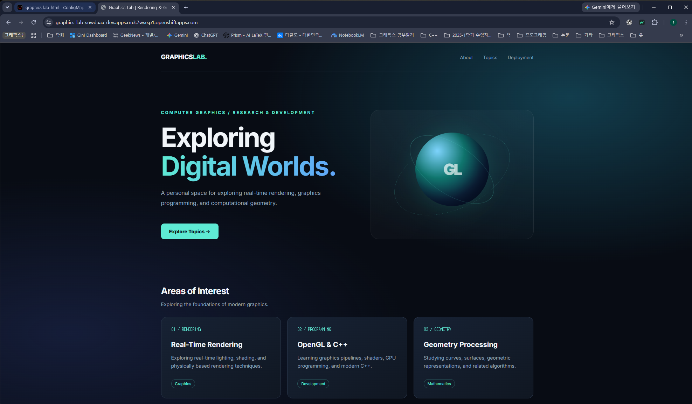
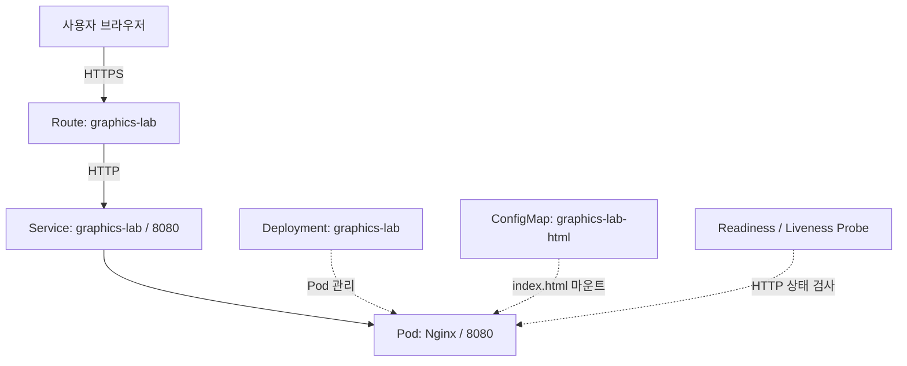
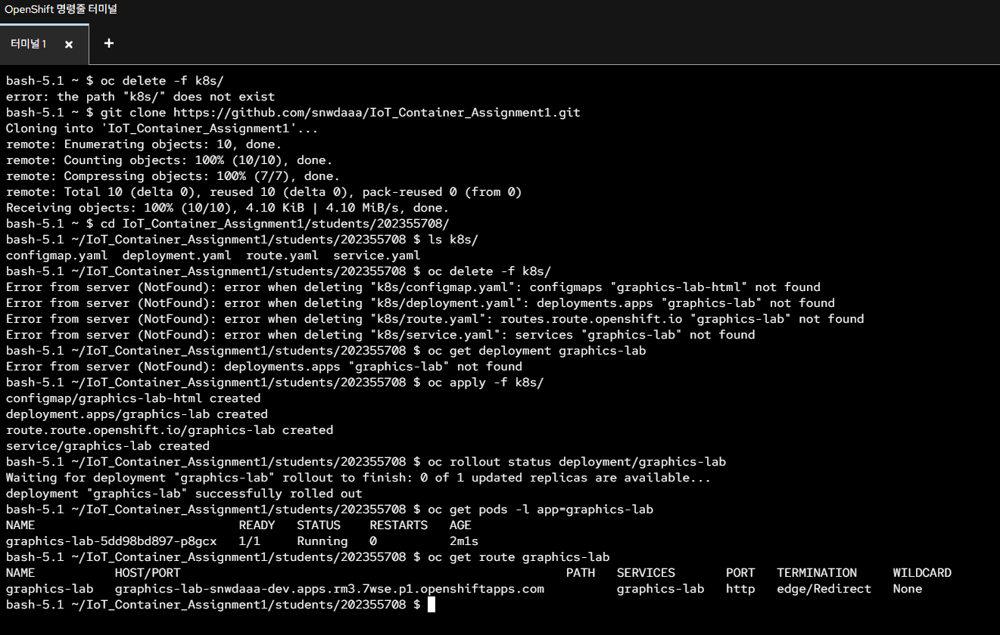
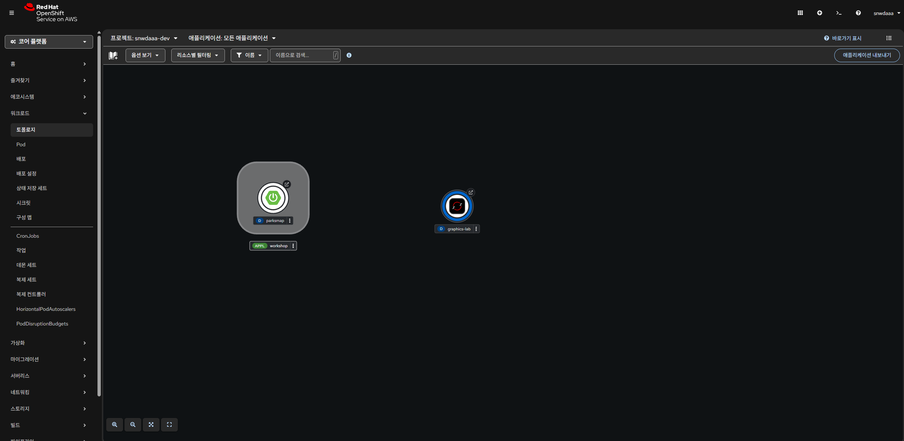

# Graphics Lab

컴퓨터 그래픽스 학습 내용을 소개하는 정적 웹사이트를 제작하고, Red Hat OpenShift Developer Sandbox에 배포한 프로젝트이다. Nginx를 웹서버로 사용했으며 HTML과 CSS는 ConfigMap으로 관리하도록 구성했다.



## 1. 프로젝트 소개

### 1.1 주제 선정 배경

평소 관심을 가지고 공부하던 컴퓨터 그래픽스를 주제로 웹사이트를 제작했다. 특히 실시간 렌더링과 그래픽스 프로그래밍, 기하 처리 분야를 소개하는 개인 학습 페이지를 만들고자 했다.

단순히 Nginx의 기본 화면을 배포하는 데 그치지 않고 직접 작성한 HTML과 CSS를 제공하도록 구성했다. 웹사이트 디자인에는 어두운 배경과 청록색 계열의 강조색을 사용했다. CSS로 구체 형태의 그래픽과 애니메이션을 구현했으며, 화면 크기에 따라 레이아웃이 바뀌도록 반응형 디자인도 적용했다.

이번 과제의 목적은 컨테이너 배포와 OpenShift의 주요 Object를 이해하는 것이므로 별도의 백엔드 서버나 데이터베이스는 사용하지 않았다.

### 1.2 주요 기능

- **Real-Time Rendering:** 실시간 조명, 셰이딩, 물리 기반 렌더링 등 관심 분야 소개
- **OpenGL & C++:** 그래픽스 파이프라인과 GPU 프로그래밍 학습 내용 소개
- **Geometry Processing:** 곡선과 곡면, 기하 알고리즘 관련 학습 분야 소개
- **반응형 웹 디자인:** PC와 모바일 환경에 맞게 레이아웃 조정
- **CSS 애니메이션:** 구체 형태의 그래픽과 호버 효과 구현

### 1.3 서비스 정보

| 항목 | 내용 |
|---|---|
| 서비스 이름 | Graphics Lab |
| 웹서버 | Nginx |
| 실행 환경 | Red Hat OpenShift Developer Sandbox |
| 프로젝트 | `snwdaaa-dev` |
| 서비스 포트 | `8080/TCP` |
| 웹사이트 | [Graphics Lab](https://graphics-lab-snwdaaa-dev.apps.rm3.7wse.p1.openshiftapps.com) |

Developer Sandbox의 이용 기간이나 운영 상태에 따라 접속이 제한될 수 있다. 다른 OpenShift 프로젝트에 배포하면 Route 주소도 새로 할당된다.

## 2. 아키텍처

### 2.1 시스템 구성



사용자가 웹사이트에 접속하면 OpenShift Route가 HTTPS 요청을 받아 Service로 전달한다. Service는 `app: graphics-lab` 레이블을 가진 Pod를 찾아 요청을 전달하고, Pod 내부에서 실행 중인 Nginx가 HTML 파일을 반환한다.

### 2.2 사용한 Object

| Object | 역할 |
|---|---|
| Deployment | Nginx 컨테이너의 실행 설정과 Pod 개수를 관리한다. |
| Pod | Nginx 컨테이너가 실제로 실행되는 단위이다. |
| Service | Pod에 안정적으로 접근할 수 있는 내부 네트워크 주소를 제공한다. |
| Route | 외부 사용자가 HTTPS 주소로 서비스에 접속하도록 연결한다. |
| ConfigMap | 웹사이트의 HTML과 CSS를 저장하고 컨테이너에 전달한다. |
| Readiness Probe | Nginx가 요청을 처리할 준비가 되었는지 검사한다. |
| Liveness Probe | Nginx가 정상적으로 동작하는지 검사한다. |

ConfigMap을 사용한 이유는 컨테이너 이미지를 다시 빌드하지 않고 웹페이지 내용을 수정하기 위해서였다.

또한 Deployment에 Readiness Probe와 Liveness Probe를 추가했다. 두 Probe는 HTTP `/` 경로를 주기적으로 검사하도록 설정했다. Readiness Probe가 실패하면 해당 Pod를 Service의 트래픽 대상에서 제외하며, Liveness Probe가 반복적으로 실패하면 컨테이너를 재시작한다.

## 3. 컨테이너 이미지 및 설정

### 3.1 이미지 선정

Red Hat에서 제공하는 UBI9 기반 Nginx 이미지를 선택했다.

```text
registry.access.redhat.com/ubi9/nginx-124:latest
```

OpenShift는 보안상 컨테이너를 임의의 비루트 사용자로 실행할 수 있다. 따라서 이러한 실행 환경을 지원하는 Red Hat UBI 기반 이미지를 사용했다.

별도의 Dockerfile은 작성하지 않았다. 기존 이미지를 그대로 사용하고 웹페이지 파일만 ConfigMap으로 제공했다.

### 3.2 컨테이너 설정

| 항목 | 설정값 |
|---|---|
| 컨테이너 이름 | `nginx` |
| 이미지 | `registry.access.redhat.com/ubi9/nginx-124:latest` |
| 실행 명령 | `nginx -g 'daemon off;'` |
| 컨테이너 포트 | `8080` |
| CPU Request | `20m` |
| CPU Limit | `200m` |
| Memory Request | `64Mi` |
| Memory Limit | `256Mi` |
| Replica 수 | `1` |
| HTML 마운트 경로 | `/opt/app-root/src` |

Developer Sandbox는 CPU와 메모리 할당량이 제한된 환경이다. 정적 웹사이트는 비교적 적은 자원으로 실행할 수 있으므로 위와 같이 리소스를 설정했다.

### 3.3 ConfigMap 활용

웹페이지의 HTML과 CSS는 `configmap.yaml`의 `index.html` 항목에 작성했다.

Deployment에서는 ConfigMap을 `/opt/app-root/src` 경로에 읽기 전용으로 마운트하도록 설정했다. Nginx는 이 경로에 있는 HTML 파일을 읽어 웹페이지를 제공한다.

웹사이트 디자인을 수정할 때도 컨테이너 이미지를 다시 빌드하지 않고 ConfigMap 내용만 변경했다.

## 4. 디렉터리 구조

과제에서 지정한 학번별 디렉터리 구조를 사용했다.

```text
students/202355708/
├── README.md
├── k8s/
│   ├── configmap.yaml
│   ├── deployment.yaml
│   ├── service.yaml
│   └── route.yaml
└── images/
    ├── command.png
    ├── website.png
    └── openshift-status.png
```

`k8s/` 폴더에는 서비스 배포에 필요한 YAML 파일을 저장했다. `images/` 폴더에는 배포 과정과 실행 결과를 촬영한 스크린샷을 저장했다.

## 5. 배포 방법

### 5.1 GitHub 저장소 복제

OpenShift 웹 터미널에서 GitHub 저장소를 복제했다.

```bash
git clone https://github.com/snwdaaa/IoT_Container_Assignment1.git
```

이후 학번 폴더로 이동했다.

```bash
cd IoT_Container_Assignment1/students/202355708
```

YAML 파일이 정상적으로 존재하는지 확인했다.

```bash
ls k8s/
```

다음 네 파일이 출력되는 것을 확인했다.

```text
configmap.yaml  deployment.yaml  route.yaml  service.yaml
```

### 5.2 OpenShift 배포

먼저 현재 프로젝트를 확인한다.

```bash
oc project
```

배포할 프로젝트를 선택한 상태에서 다음 명령을 실행한다.

```bash
oc apply -f k8s/
```

실제 실행 결과는 다음과 같았다.

```text
configmap/graphics-lab-html created
deployment.apps/graphics-lab created
route.route.openshift.io/graphics-lab created
service/graphics-lab created
```

ConfigMap, Deployment, Route, Service가 모두 생성되었다.

### 5.3 배포 상태 확인

Deployment의 롤아웃 상태를 확인했다.

```bash
oc rollout status deployment/graphics-lab
```

실행 결과:

```text
deployment "graphics-lab" successfully rolled out
```

Pod 상태도 확인했다.

```bash
oc get pods -l app=graphics-lab
```

확인한 결과, Pod는 `1/1 Running` 상태였으며 재시작 횟수는 0이었다.

Service와 Route는 다음 명령으로 확인했다.

```bash
oc get svc graphics-lab
oc get route graphics-lab
```

Route에 할당된 주소로 접속했을 때 Graphics Lab 웹사이트가 정상적으로 표시되었다.

### 5.4 삭제 및 재배포 방법

기존 리소스를 삭제한 뒤 YAML 파일만으로 다시 배포하려면 다음 명령을 사용한다.

```bash
oc delete -f k8s/
oc apply -f k8s/
oc rollout status deployment/graphics-lab
```

배포가 끝나면 Pod와 Route를 다시 확인한다.

```bash
oc get pods -l app=graphics-lab
oc get route graphics-lab
```

이때 명령은 반드시 `students/202355708` 디렉터리에서 실행해야 한다.

## 6. 배포 결과

### 6.1 GitHub YAML 배포

GitHub 저장소를 OpenShift 웹 터미널에서 직접 복제하고 `k8s/` 폴더의 YAML 파일을 배포했다.

Deployment 롤아웃이 완료되었고, Pod가 정상적으로 실행되는 것을 확인했다.



### 6.2 OpenShift 토폴로지

OpenShift 웹 콘솔의 토폴로지 화면에서 `graphics-lab` Deployment가 생성된 것을 확인했다.

기존 실습에서 사용했던 `parksmap`과 별개로 Graphics Lab을 배포했다.



### 6.3 웹사이트 접속

OpenShift가 자동으로 생성한 Route 주소로 접속했다.

[Graphics Lab 웹사이트](https://graphics-lab-snwdaaa-dev.apps.rm3.7wse.p1.openshiftapps.com)

브라우저에서 `Exploring Digital Worlds.`라는 제목과 세 개의 학습 분야 카드가 정상적으로 표시되었다.

CSS로 작성한 배경과 구체 그래픽, 애니메이션도 정상적으로 동작했다.


### 6.4 배포 검증 결과

| 확인 항목 | 결과 |
|---|---|
| GitHub 저장소 Clone | 성공 |
| YAML 파일 확인 | 성공 |
| `oc apply -f k8s/` | 성공 |
| Deployment 롤아웃 | 성공 |
| Pod 실행 | `1/1 Running` |
| Service 생성 | 성공 |
| Route 생성 | 성공 |
| 웹사이트 접속 | 성공 |

GitHub의 YAML 파일로 리소스를 새로 생성했고 정상적인 배포와 웹 접속을 확인했다.

따라서 위 결과는 GitHub YAML을 이용한 신규 배포 검증 결과이다.

## 7. 진행 중 겪은 문제

### 7.1 Route 등록 시 React 오류

OpenShift 웹 콘솔에서 Route YAML을 등록하는 과정에서 다음 오류가 발생했다.

```text
Minified React error #31
```

오류가 발생한 화면에서는 Route가 제대로 생성되었는지 확인하기 어려웠다.

그러나 OpenShift 웹 터미널에서 다음 명령으로 상태를 확인한 결과 Route가 정상적으로 생성된 것을 확인했다.

```bash
oc get route graphics-lab
```

Deployment, Pod, Service도 정상 상태였으며 실제 Route 주소로 웹사이트에 접속할 수 있었다.

이를 확인한 뒤 웹 콘솔의 화면 오류와 실제 배포 상태를 구분해 문제를 해결했다.

### 7.2 YAML 파일 경로 오류

GitHub 저장소를 복제하기 전에 다음 명령을 실행했다.

```bash
oc delete -f k8s/
```

당시 웹 터미널의 현재 디렉터리에는 `k8s/` 폴더가 없었으므로 다음 오류가 발생했다.

```text
error: the path "k8s/" does not exist
```

GitHub 저장소를 복제한 뒤 `students/202355708` 폴더로 이동해 문제를 해결했다.

이후 `ls k8s/`로 YAML 파일을 확인하고 배포 명령을 실행했다.

### 7.3 OpenShift 자동 생성 필드

OpenShift 웹 콘솔에서 Route를 생성한 뒤 YAML 내용을 확인했을 때 `uid`, `resourceVersion`, `status`, `host` 등의 필드가 자동으로 추가되어 있었다.

이 값들은 OpenShift가 리소스를 관리하면서 생성하는 정보이다. 다른 프로젝트에 같은 설정을 배포하려면 이러한 필드를 제출용 YAML에서 제외해야 한다는 점을 확인했다.

## 8. AI 및 참고자료 활용

과제를 진행하면서 ChatGPT를 사용했다.

먼저 YAML 초안을 작성하는 데 도움을 받았다.

웹페이지의 HTML과 CSS를 작성하고 디자인을 수정하는 과정에서도 ChatGPT를 활용했다. 생성한 설정은 OpenShift Developer Sandbox에서 직접 배포하고 실행 상태를 확인했다.

또한 README 초안을 작성하는 데에도 사용했다.

### 참고자료

- 부산대학교 지능형IoT플랫폼 강의자료, 「OpenShift와 함께하는 Kubernetes 핸즈온 워크샵」
- [Red Hat OpenShift Developer Sandbox](https://developers.redhat.com/developer-sandbox)
- [Red Hat Nginx Container](https://github.com/sclorg/nginx-container/blob/master/1.24/README.md)
- [Kubernetes Deployment Documentation](https://kubernetes.io/docs/concepts/workloads/controllers/deployment/)
- [Kubernetes ConfigMap Documentation](https://kubernetes.io/docs/concepts/configuration/configmap/)